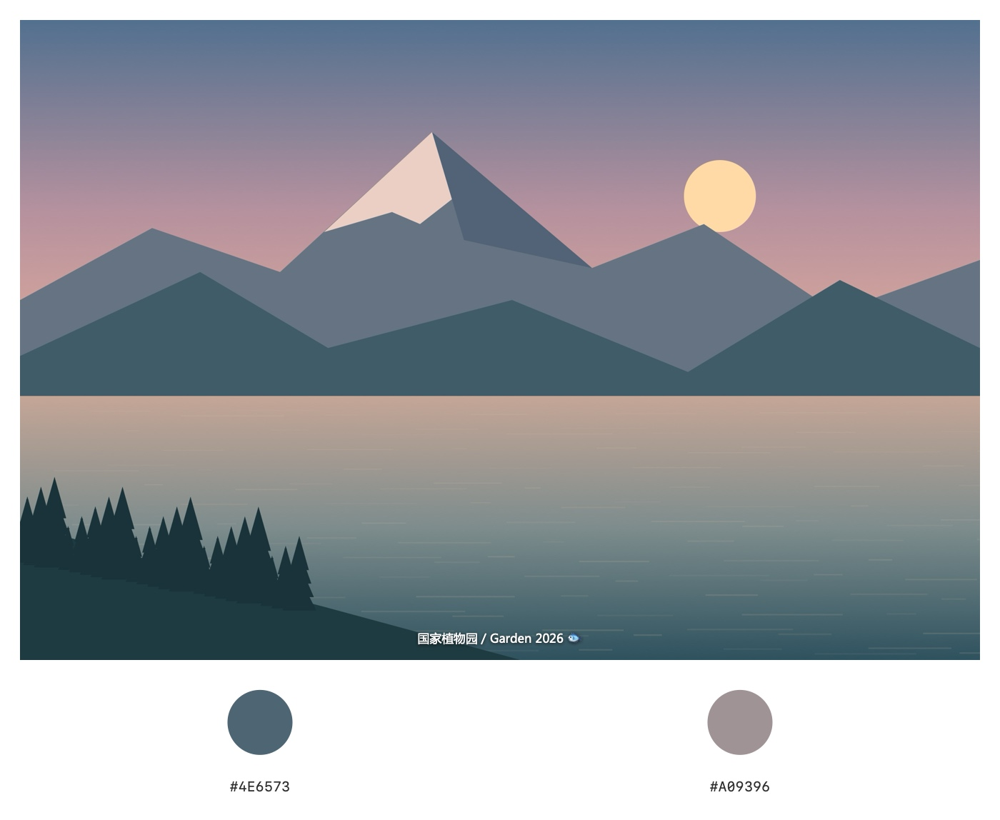
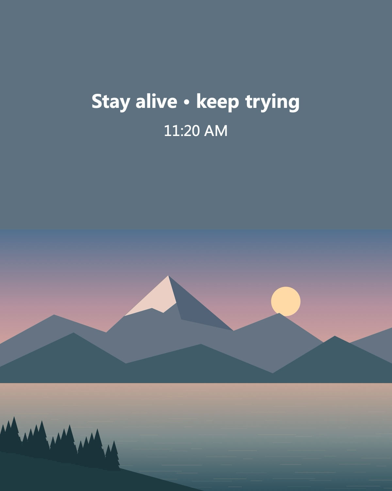
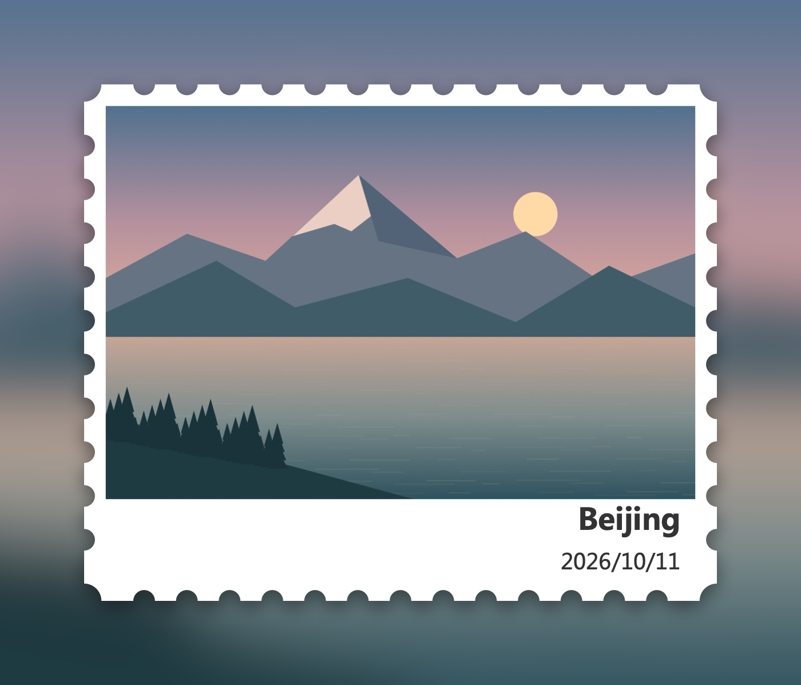
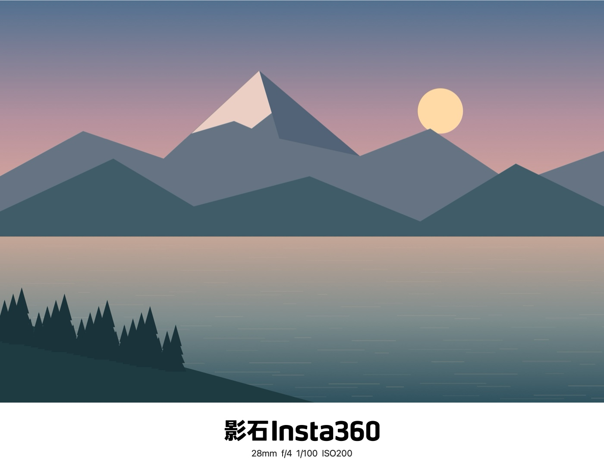

# 映框 · Frame Studio

[下载最新版](https://github.com/yuwenhan07/frame-studio/releases/latest) · [隐私说明](PRIVACY.md) · [发布审查](docs/code-review.md)

一个完全本地运行的原生 macOS 摄影水印 App。目前提供「柔焦画框」「圆形色卡」「方形色卡」「Color Walk」「邮票画框」「经典画框」「Tickets 票券」七种模板。柔焦画框以同源虚化背景、圆角主图和相机参数呈现照片；色卡在白色底栏显示照片主色与 HEX 色号；Color Walk 在照片上方铺一块代表色并加上文字盖章。邮票画框使用同源虚化背景、齿孔白边和可选的地点日期落款。经典画框在纯白底栏呈现相机品牌与拍摄信息。Tickets 票券以细齿上下边、撕线、旅行信息和右下角贴印呈现照片。主照片始终保持完整比例。

## 操作演示

约 47 秒，展示模板切换与样式调整的实际操作。

https://github.com/user-attachments/assets/c5cd2242-9a5a-452b-8c0f-407143b2f886

| 圆形色卡 | Color Walk |
| --- | --- |
|  |  |
|  |  |

预览使用程序绘制的公开示例图。

## 使用

打开 `~/Applications/映框.app`，把一张或多张照片拖入画布，或按 `⌘O` 多选导入。左侧列表可切换照片，右键可从列表移除，重复导入同一文件会自动去重。在右侧核对品牌、型号、焦距、光圈、快门、ISO，需要时添加个人落款。切换到「画框样式」可调整虚化、明暗、留白、圆角、阴影与文字大小。

支持从 macOS「照片」App 直接拖入一张或多张照片，无需先导出到桌面。通过原生文件承诺接收异步生成的图片，等待传输完成后再加载，并显示已接收数量；若部分照片传输失败，保留成功项并报告失败原因。接收的副本放在 App 的本机长期存储目录，保留传来的文件内容和 EXIF；Finder 文件继续直接读取原路径，纯位图拖拽则保存为 TIFF。列表移除不会删除照片图库原片、Finder 原片或已导出的文件。

「水印信息」中的「落款字号」滑块可独立调整个人落款大小，范围为默认字号的 50%–200%；画框样式的「文字大小」调整品牌、型号与拍摄参数。所有滑块旁的数值均支持双击恢复该项默认值，左右留白按当前照片的横竖构图分别恢复。旧版保存的落款字号会保持原来的显示大小。

个人落款提供「中文字体」和「英文字体」两个独立菜单，默认均为微软雅黑。中文及全角标点使用中文字体，英文、数字与半角符号使用英文字体；Emoji 由系统补充显示。菜单列出本机已安装字体，选择会随样式保存，并同时用于预览、单张导出和批量导出。App 不附带字体文件；若某字体未安装，界面会提示并临时使用系统字体替代。

## 自动保存与恢复

App 自动保存照片列表及顺序、当前预览、批量勾选、模板样式、文字与字体、每张照片的拍摄参数和手动颜色、导出格式与尺寸，以及自定义 Logo。编辑后短暂合并写入，正常退出前立即保存；重新打开时恢复上次会话。主动清空列表也会被记住，不重新添加示例照片。首次启动且没有会话记录时才展示示例图。

会话和 App 接收的照片副本保存在 `~/Library/Application Support/local.wenhanyu.frame-studio/`。从「照片」App 拖入的内容保存在这里，旧版本的传输缓存会在重新导入时转存，避免系统清理缓存后无法继续编辑；Finder 原片继续引用原路径，不修改或移动。自定义 Logo 保存为 App 内的 PNG 副本。移除列表项仅清理会话列表，磁盘原片、副本和已导出文件均保留。

`Session.json` 使用原子替换写入，并保留上一份有效的 `Session.previous.json`。会话损坏时尝试备份，原始损坏文件另存至 `Recovery/`。如果原片暂时不在原位置，保留照片记录和编辑，提示连接磁盘或找回文件后点击重试；同路径变成另一张图片时不会沿用旧照片参数和颜色。无法保存时会显示错误，正常退出前可返回 App 重试。

## 颜色水印

在左侧选择「圆形色卡」或「方形色卡」，右侧会自动显示「画框样式」面板。默认提取 5 种主色，可选择 2–8 色、按明暗或面积占比排序；颜色不足时保留实际数量。方形默认旋转为菱形，也可关闭旋转。HEX 使用不含透明度的标准 `#RRGGBB` 格式，可选隐藏。

白边默认占画布宽度 2%，底栏默认 16%，横竖照片均完整显示。白边可降至 0，得到照片铺满左右两侧的样式；白边、底栏和色块大小均可滑动调整并双击数字重置。为避免密集色块或低底栏相互遮挡，绘制时会按可用空间约束色块大小。个人落款可选显示在照片底部，沿用独立字号和中英文字体。

颜色从经过方向修正的原照片预览提取，不包含新加的边框、水印或文字。最长边 192 像素采样后建立颜色直方图，使用确定性的按像素数量加权聚类；颜色占比为近似值。预览和导出使用同一图像来源与取色过程；批量每张照片分别提取，避免把当前预览的颜色套给整批照片。

自动识别后可逐个手动调整：点击色块打开系统选色器，或在旁边输入六位 HEX（例如 `#AABBCC`），颜色与 HEX、预览和导出同步更新。右侧减号仅删除对应色块，其他色块保持不变；也允许删空色卡。手动修改后固定色块顺序，自动取色数量和排序暂时停用，点击「恢复自动取色」即可清除当前照片的手动调整并重新启用。

手动改色和删除按照片分别记录于本机，切换照片、切换模板，以及退出后重新导入同一原片均可恢复。记录核对文件大小和修改时间，同路径文件发生变化后重新识别。批量导出沿用各张照片自己的手动色卡，未手动修改的照片照常自动取色；空色卡不会被自动填回。移除 App 列表项不删除原片，也不删除其已保存的调色记录。

生成的示例在 `Examples/颜色水印-圆形.jpg`、`Examples/颜色水印-方形.jpg` 和 `Examples/颜色水印-竖版.jpg`。颜色模板共用原有批量勾选、导出、重名保护与列表移除功能。

## Color Walk

左侧选择「Color Walk」，照片下方保持满宽完整构图，上方铺单一色面。默认色面高度为画布宽度的 58.5%，默认文字盖章为 `Stay alive · keep trying`，第二行显示 EXIF 中的拍摄时间。也可改为拍摄日期、自定义文字或不显示第二行；没有有效拍摄时间时留空，不使用文件修改时间或当前时间代替。

自动主色使用原照片的颜色直方图与稳定聚类，综合颜色占比、饱和度和明暗选择有足够面积的色彩族，再按面积混合该族的颜色；接近黑白的照片保留中性色。自动色面保持 HSL 色相，明度仅提高剩余距离的 7%、且最多提高 0.035，同时将饱和度降至原值的 90%，形成更沉稳、柔和的色调；取整时可能产生微小色差。调整只应用一次，预览和导出共用结果，不改变照片像素、手动颜色或圆形/方形色卡。该方法是色彩统计启发式，无法保证符合每个人对照片风格的判断。点击主色色块打开系统选色器，也可输入六位 HEX；可随时恢复自动主色。手动颜色按照片独立保存，与圆形、方形色卡的改色及删除记录互不影响。

「画框样式」可编辑主文字、第二行、字体、色面高度、盖章字号、文字上下位置与文字颜色，也可隐藏盖章。「文字上下位置」滑块向左上移、向右下移，两行整体移动并保持在色面内部；默认位置为距顶部 50%，即色面中央。位置同步应用于预览、单张与批量导出，并随样式保存。字体沿用个人落款的中英文字体设置，默认微软雅黑；白色文字为默认，也可选黑色或自动对比。色面高度、盖章字号和文字上下位置均支持双击数字恢复默认，恢复默认版式不会删除自定义文字。照片保留完整比例，因此横竖原片的最终画布比例会不同。

单张预览、导出和批量导出使用同一渲染逻辑。批量共用盖章文字与版式，每张照片独立取色、保留自己的手动主色，并从各自 EXIF 读取时间。示例文件为 `Examples/Color-Walk-预览.jpg` 和 `Examples/Color-Walk-竖版.jpg`。

## 邮票画框

在左侧选择「邮票画框」，右侧的「邮票样式」可切换「纯画框」和「底部落款」。两种样式均以同一照片虚化铺底，白色纸面四边和四角使用内凹圆形齿孔，阴影沿连续的邮票轮廓绘制。齿孔为矢量路径，按导出尺寸重新绘制；横竖照片保持完整比例。

默认纯画框，外留白为画布宽度的 10.5%，白边 2.7%，齿孔半径 1.35%；底部落款增加 10% 的白栏。可滑动调整画框留白、邮票白边、齿孔大小、背景虚化、明暗与阴影；落款样式还可调整底栏和文字大小。所有数值支持双击恢复该项默认值。齿孔尺寸会根据白边和纸面短边约束，避免穿过照片；恢复邮票默认样式保留已有地点、日期、字体和当前样式版本。

底部落款在右下角显示地点和日期，地点初始为空，不猜测照片位置。日期默认从当前照片的有效 EXIF 拍摄时间读取，显示为 `yyyy/MM/dd`；也可自定义或隐藏。没有拍摄日期时留空，不使用文件日期或当前日期代替。字体沿用已有中英文字体设置，长文字按底栏空间自动缩放，不遮挡照片。

预览、单张导出和批量导出使用相同渲染流程；批量共用版式、地点与自定义日期，自动日期按各张照片分别读取。邮票设置随会话自动保存。示例为 `Examples/邮票画框-纯画框.jpg`、`Examples/邮票画框-底部落款.jpg` 和 `Examples/邮票画框-竖版.jpg`。

## 经典画框

左侧选择「经典画框」，照片完整显示在纯白底栏上方。默认品牌居中、下方显示拍摄参数；底栏布局还可选择「左文右标」与「横向信息」。可分别显示相机型号、参数、EXIF 日期和个人落款。白边默认 0，底栏默认占画布宽度 12%，品牌与信息字号默认 100%；四项均支持滑动与双击数值恢复默认。长文字根据可用区域适配，不进入照片区域。恢复默认版式保留品牌选择、布局类型、信息开关和已有文字。

品牌默认自动识别，支持 Nikon、Canon、SONY、FUJIFILM、Leica、Hasselblad、LUMIX、OLYMPUS、OM SYSTEM、PENTAX、RICOH、DJI、Insta360。优先读取照片品牌字段；品牌字段为空时尝试识别型号内的品牌名称，仍无信息时留空，未知品牌保留原文字。Insta360 同时识别 `insta 360`、`影石` 与 `Arashi Vision` 等品牌写法。也可手动选择，或选择「自定义文字」编辑当前照片的品牌名。

Nikon、Canon、SONY、FUJIFILM、Leica、Hasselblad、DJI、Insta360 使用内置矢量轮廓；保留 Canon 红色、富士红色细节与徕卡红点，关闭「使用品牌色」可改为黑白。其余品牌使用系统粗体文字。品牌字标不受个人落款字体影响；上传透明 PNG 等图片并启用后，可替换为自定义 Logo。既有模板上传的 Logo 不会自动覆盖经典品牌标志。SVG 来源和转换说明见 [品牌素材说明](Assets/BrandSources/README.md)，正常使用完全离线。

「水印信息」可修改当前照片型号、焦距、光圈、快门、ISO 和个人落款。日期仅来自有效 EXIF 原始拍摄时间，保留相机当地时间，缺失时留空。个人落款沿用独立中英文字体。开启自动品牌时，批量每张照片分别识别；手动品牌与自定义 Logo 共用于整批照片，型号、参数和日期仍分别读取。品牌、布局、开关及尺寸设置均随会话保存。

示例文件为 `Examples/经典画框-Nikon.jpg`、`经典画框-Canon.jpg`、`经典画框-SONY.jpg`、`经典画框-FUJIFILM.jpg`、`经典画框-Leica.jpg`、`经典画框-Hasselblad.jpg`、`经典画框-Insta360.jpg` 和 `经典画框-竖版.jpg`。

## Tickets 票券

左侧选择「Tickets 票券」，背景由同一照片虚化铺满，票面上下为细齿边，两侧在横向撕线处留半圆缺口。照片保持完整比例；左下方显示标题、副标题和日期，右下方可切换「旅行邮戳」「条形码」或「不显示」。默认标题为 `TICKETS`，副标题留空，日期读取当前照片有效 EXIF 并显示为 `18 OCT 2026` 这样的格式；缺失时留空，也可自定义或隐藏。

旅行邮戳含圆环、飞机和波浪线，上下弧文字可分别修改。条形码使用 Code 128，可填写不超过 48 个英文、数字或半角符号，默认 `FRAMESTUDIO`，留空隐藏。条码仅编码输入文字，不自动附加照片路径、位置或拍摄信息；识读效果受导出尺寸影响。不支持的内容会在面板提示并阻止导出，避免静默生成错误条码。

可调整票券留白、白边、底栏、齿孔、文字和贴印大小，以及背景虚化、明暗和阴影，双击滑块旁数字恢复该项默认值。「恢复票券默认版式」保留文案、贴印模式、邮戳文字、条码内容、日期模式与字体。中英文字体沿用已有独立设置。单张与批量导出共用版式，各照片分别读取日期，全部编辑随本机会话恢复。

生成示例见 `Examples/Tickets-旅行邮戳.jpg`、`Examples/Tickets-条形码.jpg`、`Examples/Tickets-不显示.jpg` 和 `Examples/Tickets-横版.jpg`。检查包含独立布局和四角像素、齿孔与撕线、贴印范围、长文字边界、日期缺失、旧设置迁移、会话与批量输出；使用 Vision 独立解码器验证实际输出中的条码内容。

## 导出与文件保护

选择尺寸与 JPEG/PNG 格式后，按 `⇧⌘E` 导出当前照片。右侧「批量选择」可逐张勾选，并提供全选、取消全选和反选。点击「导出已选」或按 `⌥⌘E`，选择一个输出文件夹，只按列表顺序导出勾选的照片；未勾选时不会导出全部。预览哪张照片与批量勾选互不影响。进度条显示已处理数量；可取消，当前照片完成后停止。

「移除已选」只从 App 的照片列表移除勾选项，不删除、不移动磁盘上的原片或已导出文件。若当前预览被移除，自动预览列表中的下一张；全部移除后显示空画布，可重新导入。

批量共用画框、落款和自定义 Logo；每张照片分别读取自己的 EXIF，手动修改的参数也分别保留。横竖照片自动应用各自的左右留白。输出文件同名时增加编号，不覆盖已有文件；单张失败后继续处理，结束时显示成功、失败和未处理数量，失败项在照片列表标红。

- 支持 JPEG、PNG、HEIC、TIFF 等系统 ImageIO 可读取的静态图片。
- 自动读取 EXIF，应用照片旋转与镜像；没有的参数留空，可手动填写。
- 柔焦画框自动区分横竖构图：横版默认左右各留 2.8%，竖版默认各留 8%，主照片保持完整比例。两种构图的左右留白可独立调整并分别记忆。颜色模板使用独立白边设置。
- 内置示例为程序绘制的原创风景图，不含个人照片或拍摄 EXIF。示例中的相机参数和时间均为演示值，不会自动套用到其他照片。
- 八个常见品牌使用内置矢量轮廓，其余品牌使用系统文字；可上传透明 PNG 自定义 Logo。
- 「原图尺寸」保留主照片的原始像素，再增加背景边框；其他选项为总画布宽度，且不会把小图放大。
- 预览与导出使用同一套渲染逻辑。预览缩小显示，导出时主照片从原图绘制。
- sRGB 输出；生成新文件，单张导出拒绝覆盖列表中任一原片（含符号链接别名），不复制 GPS 等原始 EXIF 信息。拍摄参数只以可见文字写入。
- 样式在本机自动记忆；「恢复参考图样式」可重置。自定义 Logo 与手动修改的照片参数随会话保存，退出重开后恢复。
- 导入与导出上限为 8,000 万像素；过大的原图加框后可选择较小的导出尺寸。

## 构建与安装

本机使用 Apple Silicon / macOS 27 / Swift 6.4 Command Line Tools 构建，无第三方运行库；构建脚本还需要 Python 3；部署目标 macOS 14。其他 macOS 版本和 Intel 架构尚未实际验证。

```sh
git clone https://github.com/yuwenhan07/frame-studio.git
cd frame-studio
zsh scripts/build.sh --install
```

安装脚本在已有安装时停止，避免覆盖既有版本。仅构建可使用 `zsh scripts/build.sh`，输出在 `dist/映框.app`。App 为本机 ad-hoc 签名，未经过 Apple 公证。公开安装包面向 Apple Silicon、macOS 14 及以上；旧系统和 Intel 尚未实际验证。下载后解压，将 `映框.app` 拖入「应用程序」。macOS 可能提示无法验证开发者，确认来源后可按系统的「隐私与安全性」提示允许打开。使用 App 无需网络服务或账号。

## 验证

```sh
swift run -c release FrameChecks
swift run -c release FrameChecks --input /path/to/photo.jpg
zsh scripts/check-selection.sh
```

检查覆盖独立像素夹具、EXIF 格式化、真实带方向图片、横竖构图、旧版样式迁移、空元信息、长文本与自定义 Logo、JPEG/PNG 编码和重新读取，以及批量失败继续、重名保护和取消。传入本地图片可生成 `Examples/柔焦画框-预览.jpg`；输入图片加 `--full` 可同时验证原尺寸导出。

字体检查覆盖混合中英文、扩展汉字、组合重音与 Emoji、独立字体的实际渲染和旧样式迁移。颜色检查包含已知 RGB 与面积比例、稳定取色、单色和透明图片、色块像素与 HEX 一致性、圆形/方形/菱形、横竖画布、独立批量取色和样式保存。

选择检查直接调用 App 的模型，核对部分勾选的实际导出结果、预览与勾选独立、全选/取消/反选、移除后的画布与异步状态，并逐字节确认原片保持不变、已有导出文件仍保留。

手动调色检查覆盖 HEX 校验、选色器 RGB 同步、逐个删除、稳定色块 ID、过期选色器回调隔离、逐照片保存和新会话恢复、原片变化识别、导出任务快照，以及自动/手动/空色卡混合批量输出。

拖拽检查覆盖文件路径、纯位图、非图片拒绝、去重、顺序、接收进度、混合失败与源文件保护。异步文件承诺的乱序与错误通过注入传输边界检查；AppKit 的实际文件承诺只能在系统拖拽会话中兑现，另以「照片」App 实际拖入验证。

Color Walk 检查覆盖已知颜色与主体/中性照片取色、横竖独立布局预期、主照片四角像素、手动主色的实际输出、原始 EXIF 时间及缺失处理、长中英文盖章、上下位置与安全边距、文字对比、旧版设置迁移、按照片改色与缓存失效，以及自动/手动颜色混合批量导出。

邮票检查覆盖四边齿孔的独立像素、凹角和白边、横竖布局、主图四角、缺失和非法日期、落款与长文字边界、极端全景、原图尺寸、批量输出和旧设置迁移。

经典画框检查覆盖品牌别名、未知品牌和空信息、八个矢量标志实际绘制、品牌色与黑白模式、三种布局、横竖构图、照片四角、长文本边界、自定义 Logo 开关、混合品牌逐张批量识别及旧样式迁移。

会话检查使用临时目录与独立进程验证真实重新启动，覆盖自动保存、立即退出前保存、逐图参数、空色卡、手动主色、勾选、Logo、导出设置、缓存转存、空列表恢复、原片失联与替换、损坏备份恢复和写入失败。

## 后续模板

- `Sources/FrameCore/Template.swift`：模板 ID、可保存的样式参数、比例布局与导出尺寸。
- `Sources/FrameCore/Renderer.swift`：Core Image 背景、Core Graphics 主图和阴影、Core Text 文字。
- `Sources/FrameCore/PhotoDocument.swift`：图片导入、方向修正、EXIF 与编码。
- `Sources/FrameCore/BatchExporter.swift`：逐张导出、重名保护、失败记录和取消。
- `Sources/FrameCore/PhotoPalette.swift`：主色提取、面积比例与稳定排序。
- `Sources/FrameCore/ColorWalk.swift`：代表色选择、盖章第二行内容与文字颜色。
- `Sources/FrameCore/PostageFrame.swift`：邮票版本、日期、纸面布局与连续齿孔轮廓。
- `Sources/FrameCore/TicketFrame.swift`、`TicketRenderer.swift`：票券轮廓、日期、邮戳、Code 128 与底栏绘制。
- `Sources/FrameCore/ClassicFrame.swift`、`ClassicRenderer.swift`：品牌识别、经典布局与底栏绘制。
- `Sources/FrameCore/BrandVectors.swift`：从固定来源生成的本地品牌矢量轮廓。
- `Sources/FrameCore/SignatureTypography.swift`：中英文字体分配与缺失字体补全。
- `Sources/FrameApp/StudioSessionStore.swift`：完整会话、有效备份与长期素材存储。
- `Sources/FrameApp/PhotoPaletteEdits.swift`：逐照片手动色卡记录与原片指纹核对。
- `Sources/FrameApp/PhotoDropImporter.swift`、`PhotoDropHostingView.swift`：原生拖拽目的地、异步文件承诺与导入缓存。
- `Sources/FrameApp/`：SwiftUI 本地界面、异步预览和保存面板。

后续模板可在模板 ID、布局和渲染分支中扩展，继续复用导入、元信息编辑和单张、批量导出流程。尚未提供用户自行配置模板功能。

## 发布与授权

源码采用 [MIT License](LICENSE)，品牌标志及其派生路径保留各品牌权利，不属于 MIT 授权范围；见 [第三方素材说明](THIRD_PARTY_NOTICES.md)。本项目与这些品牌无隶属或背书关系。App 不附带微软雅黑或其他第三方字体。

`swift scripts/GenerateSample.swift` 可重新生成原创示例图。检查产生的 `Examples/`、本机构建产物和 `dist/` 均被 Git 忽略，不随源码上传。发布包仅包含 App，不包含本机会话、导入照片、缓存或用户偏好。
